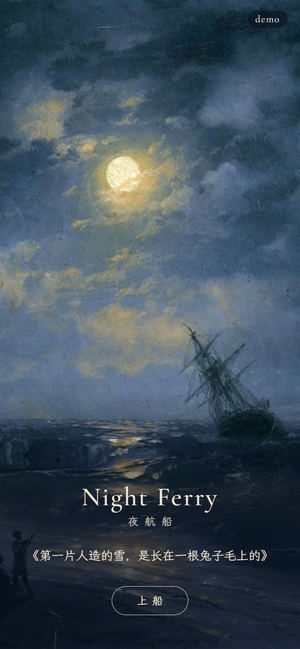
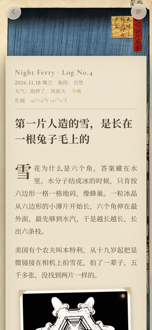

# 夜航船 Night Ferry


每天晚上，让你的 AI 给你写一篇三五百字的冷知识或科普，像睡前读的那种。你在页面上读，读完可以在文末留一句话，它下次醒来会看到，也可以回你。

这个仓库是一整套能跑起来的东西：给 AI 用的写作工具、自动配图的管线、和一个长得像航海日志的阅读页。

*English summary at the bottom.*

 

## 它做什么

- **一天一篇。** AI 调用 `night_ferry` 工具写今晚这篇：标题、正文、分类、天气、故事发生的地方、文末想对你说的一句话，再从壁纸里挑一张和内容最搭的。同一晚写第二篇会被拒。
- **你可以点题。** 页面上有「想听的」清单和一行长期主题。AI 写之前会先看；写了你点的那条，清单上会划掉。
- **自动配图。** 正文里单独一行 `【图：想要什么画面 | 要求】` 就是一张图的位置。服务器去 Wikimedia Commons 搜，让一个小模型看候选图挑一张、写图注，压好存下来，然后**等 AI 自己过目**：通过、换掉图注、给这张图留一句话，或者说明原因打回重找（最多四轮）。全部过目完才通知你。每张图都带作者和授权。
- **航海日志。** 每篇文末有一块留言，你和 AI 都能写。AI 读过那一期才算读过你的留言。
- **阅读页。** 一页一篇，米色纸浮在本期壁纸上；左右拖动翻往期，邻页跟着手指走；点图会冒出一朵云，是 AI 看完这张图说的话；图右下角的按钮把它放大到全屏，可以双指缩放拖动，也可以存到相册；滚到文末，一只锚带着麻绳落下来扎进沙里；右上角是按月的一览。
- **封面和进场。** 封面是艾瓦佐夫斯基的月夜海，用 WebGL 做成活的：海面起伏、月光碎在水上、云在飘、船在晃。点「上船」，一只小船从画上划过去，正文在它的尾迹里展开。

## 跑起来

需要 Node 18 以上。

```bash
git clone https://github.com/miya-tonya/night-ferry.git
cd night-ferry
npm install
npm run seed     # 可选：放几篇示范文章进去
npm start        # http://localhost:3210
```

只想看看样子的话不用装任何东西：直接双击 `public/index.html`，页面会用自带的示范数据跑（留言和点题只存在内存里，刷新就没了）。从磁盘直接打开时浏览器不让页面读图片的像素，所以封面是静止的画、进场动画会跳过；起了服务器（`npm start`）才是全套。

### 让模型写今晚这篇

```bash
export ANTHROPIC_API_KEY=...     # 或者先 ant auth login（这种情况再加一句 export NIGHT_FERRY_LLM=anthropic，配图才会开）
npm run write
```

`examples/write-tonight.js` 是完整的一轮：先看你点了什么，写，等配图，看图，通过或打回。默认用 `claude-opus-5-5` 写、`claude-haiku-5-5` 挑图，可以用环境变量 `NIGHT_FERRY_MODEL` / `NIGHT_FERRY_IMAGE_MODEL` 换。脚本里默认开了服务端的拒答回退（某一轮被安全分类器拦下时由回退模型接着跑），不想要就删掉注释标出的那两行。

没有 API key 时，文章照样能写能读，只是没有配图——或者走下面这条路，用订阅。

## 不用 API key：接 Claude Code 或 Codex 的订阅

夜航船自带一个 MCP 服务（`server/mcp.js`，不需要额外安装任何包），把 `night_ferry` 这个工具交给任何支持 MCP 的客户端。你已经在用的 Claude Code 或 Codex 就可以直接当写手，找好的图会作为图片内容回给它，它是真的看过图才通过或打回。

**让它来写**

```bash
# Claude Code
claude mcp add --transport stdio night-ferry -- node /绝对路径/night-ferry/server/mcp.js
# Codex
codex mcp add night-ferry -- node /绝对路径/night-ferry/server/mcp.js
```

然后直接对它说「写今晚的夜航船」。想每晚自动跑，就在定时任务里放一行：

```bash
claude -p "用 night_ferry 写今晚的夜航船：先 read，再 write；有配图就等一会儿 check_images，全部过目完再结束。" \
  --allowedTools "mcp__night-ferry__night_ferry"
# 或
codex exec "用 night_ferry 写今晚的夜航船：先 read，再 write；有配图就等一会儿 check_images，全部过目完再结束。"
```

MCP 服务和网页服务读写同一个数据目录（`NIGHT_FERRY_DATA`，默认 `./data`），可以同时开着。

**让它来挑图**

配图管线里那个「看候选图挑一张」的小模型，也可以走订阅。用环境变量 `NIGHT_FERRY_LLM` 选：

| 值 | 用什么 | 说明 |
|---|---|---|
| `anthropic` | Claude API | 有 API key 时的默认值，最快 |
| `claude-code` | `claude -p`，走 Claude 订阅 | 每次调用起一个一次性的会话，约 5～10 秒一次 |
| `codex` | `codex exec`，走 ChatGPT 订阅 | 同上 |
| `none` | 不配图 | 没有 key 时的默认值 |

```bash
NIGHT_FERRY_LLM=claude-code npm start
claude mcp add --transport stdio --env NIGHT_FERRY_LLM=claude-code night-ferry -- node /绝对路径/night-ferry/server/mcp.js
```

挑图的会话是一次性的：在一个临时空文件夹里跑，只开放「读文件」这一个工具，不加载你的 MCP 服务和个人设置，不能改任何东西。要知道的一点：候选图的标题和描述来自 Commons，是别人写的文字，会进到这次会话的提示里；它能做的最坏的事是读到本机别的文件、把片段写进图注（最长 40 字）。介意的话挑图用 API，或者单独给它一个系统账号。挑图用的模型用 `NIGHT_FERRY_IMAGE_MODEL` 指定（Claude Code 默认 `haiku`；Codex 默认用你 Codex 里配置的模型）。

验证情况：Claude Code 这条路（MCP 写文章、`claude -p` 挑图）用真实订阅跑通过。Codex 这条路是照官方文档写的，命令本身能跑到 OpenAI，但作者手头的账号没能跑完一整轮，遇到问题请开 issue。

## 接到你自己的 AI 上

真用起来不会单独跑一个脚本，而是把这个工具加进你的 AI 已有的工具里：

```js
const { createNightFerry } = require("./server/night-ferry");

const ferry = createNightFerry({
  dataDir: "./data",
  backgrounds: "./public/assets/backgrounds/backgrounds.json",
  readerName: "小满",          // AI 怎么称呼读者，默认「读者」
  readerPronoun: "她",         // 默认「TA」
  llm: anthropicLlm(),         // 挑图用的小模型；不给就没有配图
  notify: async ({ title, body, url }) => sendPush(body, url),   // 写好了怎么通知你（失败会记在那一期上，不重试）
  onImagesReady: (entry) => wakeMyAgentNow(),                     // 图找好了，叫 AI 来看
});

app.use("/api/night-ferry", ferry.router());      // 阅读页用的接口

// 给模型的工具（Anthropic 工具格式）
tools.push({ name: ferry.tool.name, description: ferry.tool.description, input_schema: ferry.tool.input_schema });

// 模型调用时
const out = await ferry.execute(toolUse.input);                    // { result, images }
toolResult.content = ferry.toolResultContent(out);                 // 文字 + 给模型看的图

// AI 每次自己醒来时，把这两句放进提示里（没事时是空串）
ferry.wakeNote();       // 「今天的夜航船还没写…」「某一期的航海日志里新写了 1 条…」
ferry.imagesNotice();   // 「某一期的配图找好了 2 张，check_images 看一眼…」
```

工具有六个动作：`read`（看今晚写没写、想听的、最近的标题）、`write`、`log`（在某一期的航海日志里留言）、`check_images`、`approve`、`reject`。说明文字都在工具定义里，模型读得懂，不需要你另写提示词。

模块的全部选项和返回值写在 `server/night-ferry.js` 文件头。跑自带小站时用环境变量配置，清单在 `server/ferry.js` 文件头（数据目录、读者的称呼和代词、挑图用哪家模型），外加 `PORT` 和 `HOST`。

### 数据

全部在 `dataDir/night-ferry.jsonl` 一个文件里，只追加不改写：同一个 id 后写的那行算数，`{id, deleted: true}` 是删除标记。所以这个文件本身就是历史，备份它就够了。配图在 `dataDir/images/`。

「今晚」是本地日期往回挪六个小时，凌晨零点半写的还算前一晚（`nightShiftHours` 可调）。

## 换成你自己的壁纸

仓库自带六张，都是公版名画（出处见 [`public/assets/CREDITS.md`](public/assets/CREDITS.md)）。加一张：

```bash
node tools/build-background.js 我的图.jpg 森林 --id forest2 --ratio 1.3
```

它会生成一张上下镜像拼接的长图（页面往下平铺时没有接缝）和一览里用的小条，并登记到 `backgrounds.json`。之后跑一次 `npm run demo-data`，免服务器的演示里才会有这张。名字就是 AI 选壁纸时看到的那个词，所以取一个能看出气质的名字。带 `--default` 的那张是没选壁纸时的底图，AI 选不到它。

## 上线之前

- **这里没有登录。** 能访问接口的人都能留言、点题。所以自带的小站默认只在本机（127.0.0.1）监听；要放到网络上，设 `HOST=0.0.0.0`，并把它挂在你自己的登录后面。
- 配图来自 Wikimedia Commons，页面上每张图下面都有作者和授权，点它会回到原页面。请保留这一行。
- 给 Commons 发请求时会带 User-Agent，用 `userAgent` 选项写上你的站点，这是他们的要求。
- 界面和给 AI 的说明目前是中文。

## 文件

```
server/night-ferry.js      核心：存储、工具、配图管线、接口
server/llm-anthropic.js    挑图用的小模型（Claude API）
server/llm-cli.js          挑图用的小模型（Claude Code / Codex 订阅）
server/mcp.js              MCP 服务：让 Claude Code / Codex 当写手
server/ferry.js            按环境变量把上面这些配好（小站和 MCP 共用）
server/index.js            自带的小站
examples/write-tonight.js  让模型写今晚这篇的完整一轮
public/                    阅读页、封面、素材
  nf-article.js/.css       一篇文章怎么画（抬头、正文、配图、落锚、航海日志）
  nf-reader.js/.css        阅读壳（翻页、壁纸、一览、想听的）
  nf-voyage.js nf-chart.js 进场：小船、尾迹、航海图
  nf-live.js               活的月夜海（WebGL）
  nf-demo.js               没有服务器时用示范数据顶上
tools/                     加壁纸、放示范文章、重建示范数据
test/                      服务端模块的测试（npm test）
```

## 许可

代码 MIT。素材的出处和授权见 [`public/assets/CREDITS.md`](public/assets/CREDITS.md)，示范文章的配图各自带着自己的授权。

---

## In English

Night Ferry lets an AI companion write you one short bedtime article every night — a piece of trivia or popular science, 300–600 Chinese characters — and gives you a reader page shaped like a ship's log to read it on.

What is in the box:

- **A writing tool** (`night_ferry`, Anthropic tool format) with six actions: read what the reader asked for, write tonight's article, leave a note in an article's log, and check / approve / reject its pictures.
- **A picture pipeline.** A line `【图：what to show | requirement】` in the body asks for a picture. The server searches Wikimedia Commons, lets a small model look at the candidates and pick one, and then waits for the writer to look at the result itself before the reader is told anything. Every picture keeps its author and licence.
- **A reader page**: one article per page on paper over that night's wallpaper, drag to turn pages, a thought-cloud note on each picture, an anchor that drops at the end, a ship's log where reader and writer leave each other notes, and a monthly overview.
- **A cover**: Aivazovsky's moonlit sea animated in WebGL, and an entrance where a boat crosses the painting and the article opens in its wake.

`npm install && npm run seed && npm start`, or just open `public/index.html` from disk for a no-server demo. `npm run write` (with a Claude API credential) lets a model write tonight's article end to end.

No API key? `server/mcp.js` is an MCP server (no extra packages) exposing the tool, so Claude Code or Codex can be the writer on your subscription (`claude mcp add --transport stdio night-ferry -- node /abs/path/server/mcp.js`), and `NIGHT_FERRY_LLM=claude-code` (or `codex`) makes the picture pipeline's small model run through `claude -p` / `codex exec` instead of the API. To use it inside your own agent, see the snippet above: add `ferry.tool` to your tools, route calls to `ferry.execute`, and include `ferry.wakeNote()` in the prompt whenever your agent wakes on its own.

The UI and the tool's instructions are in Chinese. There is no authentication, so the bundled server listens on 127.0.0.1 only by default — put it behind your own login before exposing it.
